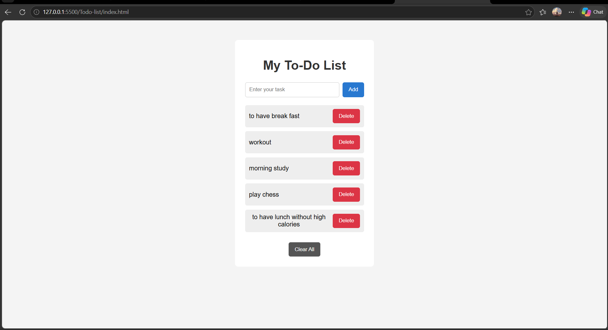

# Ex03 To-Do List using JavaScript
## Date:17-11-26

## AIM
To create a To-do Application with all features using JavaScript.

## ALGORITHM
### STEP 1
Build the HTML structure (index.html).

### STEP 2
Style the App (style.css).

### STEP 3
Plan the features the To-Do App should have.

### STEP 4
Create a To-do application using Javascript.

### STEP 5
Add functionalities.

### STEP 6
Test the App.

### STEP 7
Open the HTML file in a browser to check layout and functionality.

### STEP 8
Fix styling issues and refine content placement.

### STEP 9
Deploy the website.

### STEP 10
Upload to GitHub Pages for free hosting.

## PROGRAM
```
index.html


<!DOCTYPE html>
<html lang="en">
<head>
    <meta charset="UTF-8">
    <meta name="viewport" content="width=device-width, initial-scale=1.0">
    <title>My To-Do List</title>
    <link rel="stylesheet" href="style.css">
</head>
<body>

    <div class="container">
        <h1>My To-Do List</h1>

        <div class="input-area">
            <input type="text" id="taskInput" placeholder="Enter your task">
            <button id="addBtn">Add</button>
        </div>

        <ul id="taskList"></ul>

        <button id="clearBtn" class="clear-btn">Clear All</button>
    </div>

    <script src="script.js"></script>
</body>
</html>


style.css:


body {
    font-family: Arial, sans-serif;
    background-color: #f4f4f4;
    margin: 0;
    padding: 50px 15px;
}

.container {
    width: 350px;
    max-width: 100%;
    margin: auto;
    padding: 25px;
    background-color: white;
    border-radius: 8px;
    text-align: center;
    box-sizing: border-box;
}

h1 {
    color: #333;
    margin-bottom: 25px;
}

.input-area {
    display: flex;
    gap: 8px;
}

input {
    flex: 1;
    min-width: 0;
    padding: 10px;
    border: 1px solid #ccc;
    border-radius: 5px;
}

button {
    padding: 10px 15px;
    background-color: #2878d0;
    color: white;
    border: none;
    border-radius: 5px;
    cursor: pointer;
}

button:hover {
    background-color: #1c5fa8;
}

ul {
    padding: 0;
    margin-top: 20px;
}

li {
    list-style: none;
    background-color: #eee;
    padding: 10px;
    margin-bottom: 10px;
    display: flex;
    justify-content: space-between;
    align-items: center;
    gap: 10px;
    border-radius: 5px;
    cursor: pointer;
    overflow-wrap: anywhere;
}

li.completed span {
    text-decoration: line-through;
    color: gray;
}

.delete-btn {
    background-color: #dc3545;
    flex-shrink: 0;
}

.delete-btn:hover {
    background-color: #b52a37;
}

.clear-btn {
    background-color: #555;
    margin-top: 10px;
}

.clear-btn:hover {
    background-color: #333;
}

script.js


let taskInput = document.getElementById("taskInput");
let taskList = document.getElementById("taskList");
let addBtn = document.getElementById("addBtn");
let clearBtn = document.getElementById("clearBtn");

// Load saved tasks
let tasks = JSON.parse(localStorage.getItem("tasks")) || [];

// Display all tasks
function displayTasks() {
    taskList.innerHTML = "";

    tasks.forEach(function(task, index) {
        let li = document.createElement("li");

        if (task.completed) {
            li.classList.add("completed");
        }

        let span = document.createElement("span");
        span.textContent = task.name;

        // Mark task as completed
        span.onclick = function() {
            tasks[index].completed = !tasks[index].completed;
            saveTasks();
            displayTasks();
        };

        // Delete button
        let deleteBtn = document.createElement("button");
        deleteBtn.textContent = "Delete";
        deleteBtn.className = "delete-btn";

        deleteBtn.onclick = function() {
            tasks.splice(index, 1);
            saveTasks();
            displayTasks();
        };

        li.appendChild(span);
        li.appendChild(deleteBtn);

        taskList.appendChild(li);
    });
}

// Add a new task
function addTask() {
    let taskName = taskInput.value.trim();

    if (taskName === "") {
        alert("Please enter a task!");
        return;
    }

    tasks.push({
        name: taskName,
        completed: false
    });

    taskInput.value = "";

    saveTasks();
    displayTasks();
}

// Save tasks in local storage
function saveTasks() {
    localStorage.setItem("tasks", JSON.stringify(tasks));
}

// Clear all tasks
function clearTasks() {
    tasks = [];
    saveTasks();
    displayTasks();
}

// Button events
addBtn.onclick = addTask;
clearBtn.onclick = clearTasks;

// Add task when Enter is pressed
taskInput.addEventListener("keypress", function(event) {
    if (event.key === "Enter") {
        addTask();
    }
});

// Display saved tasks when page loads
displayTasks();

```

## OUTPUT

## RESULT
The program for creating To-do list using JavaScript is executed successfully.
